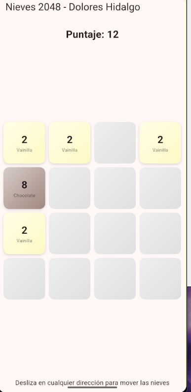
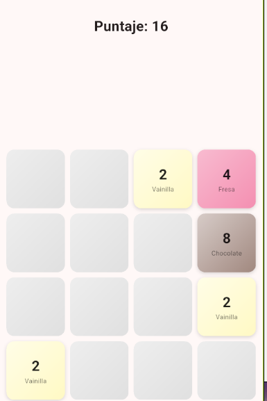
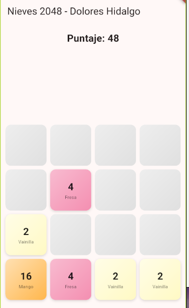
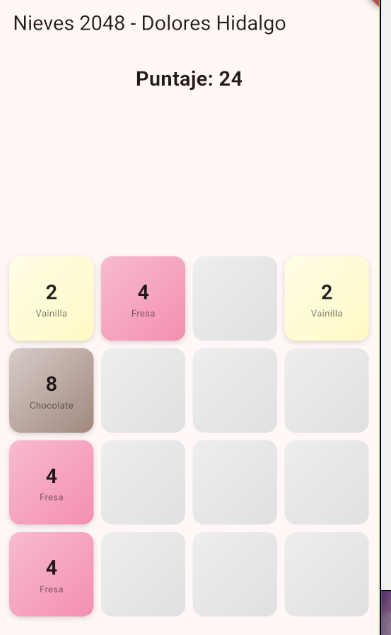

# Pruebas del Sistema - Punto de Venta Dolores

## Descripción
Este repositorio contiene el código fuente y las evidencias de las pruebas realizadas para el sistema de punto de venta.

## Pruebas Realizadas

### 1. Vista de Chocolate (Inventario / Selección)
* **Descripción:** Verificación de la carga y selección de productos bajo la categoría de chocolate en el sistema.
* **Resultado:** Exitoso.
* **Evidencia:**  
  

### 2. Vista de Fresa (Módulo de Transacción)
* **Descripción:** Pruebas en el flujo de ventas seleccionando variantes de fresa y validando el puntaje o total acumulado.
* **Resultado:** Exitoso.
* **Evidencia:**  
  

### 3. Vista de Naranja (Buscador y Catálogo)
* **Descripción:** Validación de la funcionalidad de la interfaz y la actualización dinámica del catálogo de productos.
* **Resultado:** Exitoso.
* **Evidencia:**  
  

### 4. Vista de Vainilla (Desglose de Monto)
* **Descripción:** Verificación del cálculo de totales y registros almacenados correctamente en la base de datos local.
* **Resultado:** Exitoso.
* **Evidencia:**  
  

## Tecnologías Utilizadas
* **Framework:** Flutter (Dart)
* **Base de datos:** SQLite (`sqflite`)
```
